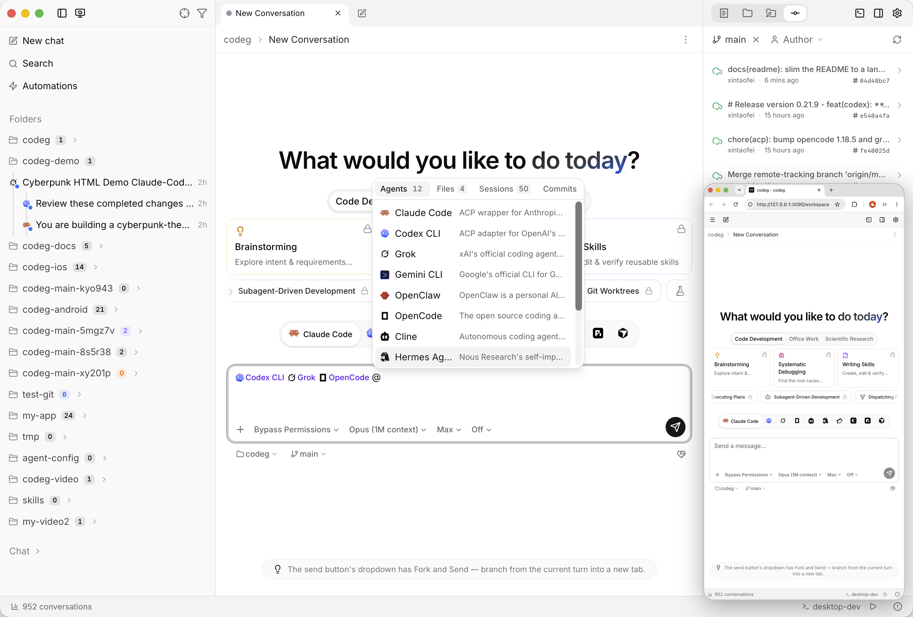

<h1 align="center">
   نسخة Codeg المخصّصة
</h1>

<p align="center">
  <a href="https://github.com/keh4l/codeg/releases/latest"></a>
  <a href="https://github.com/spacering-net/codeg"></a>
  <a href="../../LICENSE"></a>
</p>

<p align="center">
  <sub><a href="../../README.md">简体中文</a> · <a href="./README.en.md">English</a> · <a href="./README.zh-TW.md">繁體中文</a> · <a href="./README.ja.md">日本語</a> · <a href="./README.ko.md">한국어</a> · <a href="./README.es.md">Español</a> · <a href="./README.de.md">Deutsch</a> · <a href="./README.fr.md">Français</a> · <a href="./README.pt.md">Português</a> · <strong>العربية</strong></sub>
</p>

<p align="center">
  <strong><a href="https://github.com/spacering-net/codeg">Codeg</a>، مساحة العمل البرمجية متعددة الوكلاء من xintaofei، بتخصيص keh4l</strong><br/>
  كل وكلاء البرمجة بالذكاء الاصطناعي في مكان واحد، يعملون معًا. تتابع المشروع الأصلي عن قرب وتضيف بعض الميزات.
</p>

<h3 align="center"><a href="https://github.com/keh4l/codeg/releases/latest"><ins>التنزيل</ins></a> · <a href="#التثبيت"><ins>طريقة التثبيت</ins></a> · <a href="https://docs.codeg.app"><ins>التوثيق الرسمي</ins></a></h3>

<p align="center">
  <picture>
    <source media="(prefers-color-scheme: dark)" srcset="../images/workspace-dark.png" />
    
  </picture>
</p>

## الاختلافات عن النسخة الرسمية

<table>
  <tr>
    <td width="50%" valign="top">🪟 <strong>علامات تبويب لكل نافذة</strong><br/>عند فتح عدة نوافذ على الخادم نفسه، يمكنك إيقاف مزامنة علامات التبويب لتحتفظ كل نافذة بعلاماتها؛ وتبقى المحادثات والرسائل متزامنة.</td>
    <td width="50%" valign="top">💭 <strong>يعرض Claude Code تفكيره</strong><br/>يطلب من الواجهة البرمجية ملخّصات للتفكير، فلا يبقى قسم التفكير فارغًا.</td>
  </tr>
  <tr>
    <td width="50%" valign="top">🌐 <strong>ترجمة الردود والرسائل</strong><br/>يُترجم كل جزء من رد الوكيل إلى لغتك فور اكتماله، ومعه التفكير وبطاقات الأسئلة وقوائم المهام، وتُترجم الرسالة إلى الإنجليزية بضغطة زر، بنماذج الترجمة من Alibaba Cloud أو Tencent Cloud، في نحو ثانية لكل 1000 حرف.</td>
    <td width="50%" valign="top">🧩 <strong>جلسات الوكلاء الفرعيين في Claude Code</strong><br/>تحصل بطاقات الوكلاء الفرعيين على «عرض جلسة الوكيل الفرعي»، الذي يفتح محادثته الكاملة كما هو الحال في Codex؛ ويمكن متابعة الوكيل الفرعي أثناء عمله.</td>
  </tr>
  <tr>
    <td width="50%" valign="top">📱 <strong>التبديل بين المحادثات المفتوحة على الهاتف</strong><br/>على الهاتف، المس عنوان المحادثة لترى كل المحادثات المفتوحة وإلى أين وصلت كل منها، ثم المس إحداها للانتقال إليها؛ ويُنبّهك العنوان حين تكون محادثة أخرى بانتظارك.</td>
    <td width="50%" valign="top">🎨 <strong>الوكلاء يولّدون الصور</strong><br/>أدخل عنوان OpenAI أو Grok أو Gemini أو أحد الوسطاء ومفتاحه ونماذجه، فيستطيع كل وكيل يدعم MCP توليد الصور وتعديلها وحفظها حيث يحدد؛ تظهر الصورة في المحادثة، ولا يمر المفتاح عبر الوكيل أبدًا.</td>
  </tr>
  <tr>
    <td width="50%" valign="top">⏳ <strong>نتائج حتى للوكلاء ذوي المهلة القصيرة</strong><br/>بعض الوكلاء لا ينتظرون استدعاء الأداة إلا من 30 إلى 60 ثانية. تحدّد هذه النسخة لكل وكيل مدة كل انتظار، فتعود في الوقت المناسب وتجلب الباقي في الاستدعاء التالي، فلا يُعدّ ردك المتأخر على سؤال عدمَ رد.</td>
    <td width="50%" valign="top">🗂️ <strong>الوكلاء الذين تستخدمهم فقط</strong><br/>تعرض الإعدادات الوكلاء الذين أضفتهم فقط، والبقية في «إضافة وكلاء» مع البحث وإضافة عدة وكلاء دفعة واحدة. التثبيت الجديد يفعّل المثبّت على هذا الجهاز فقط، فيبقى منتقي المحادثة الجديدة قصيرًا.</td>
  </tr>
  <tr>
    <td width="50%" valign="top">📋 <strong>تحديد النص بالضغط المطوّل على الهاتف</strong><br/>الضغط المطوّل على نص في رد أو في مربع الرسالة يُظهر مقابض التحديد وقائمة النسخ الخاصة بالهاتف بدل قائمة المحادثة؛ وعند تحديد رد بالإصبع تظهر «نسخ النص / اقتباس / اسأل» أسفل مربع الرسالة بعيدًا عن قائمة الهاتف.</td>
    <td width="50%" valign="top">🔁 <strong>إعادة تشغيل الخادم من الويب</strong><br/>أُضيف «إعادة تشغيل codeg» إلى الإعدادات ← النظام: يُعاد تشغيل codeg المنشور على خادم دون تسجيل الدخول إلى الخادم، وتعيد الصفحة الاتصال تلقائيًا؛ وصار استعادة نسخة احتياطية على خادم يعيد التشغيل أيضًا لتسري.</td>
  </tr>
  <tr>
    <td colspan="2" valign="top">🔄 <strong>مواكبة المشروع الأصلي</strong><br/>تُدمج تحديثات المشروع الأصلي بانتظام؛ وكل ما لم يُذكر هنا يعمل كما في النسخة الرسمية. أصبح ‏Kiro CLI المدمج، وهو أول ما أضافته هذه النسخة، جزءًا من النسخة الرسمية منذ الإصدار 0.36.0.</td>
  </tr>
</table>

<details>
<summary>تفاصيل: <strong>علامات تبويب لكل نافذة</strong></summary>
<br/>

- يتحكم في ذلك مفتاح «مزامنة علامات تبويب المحادثات بين النوافذ» في الإعدادات ← عام، وهو مفعّل افتراضيًا: تتشارك كل النوافذ والأجهزة المتصلة بالخادم (الحاسوب والجهاز اللوحي والهاتف) مجموعة واحدة من علامات التبويب المفتوحة كما في الإصدار الرسمي.
- عند تعطيله، يترك فتح علامة تبويب محادثة أو التركيز عليها أو إغلاقها في نافذة النوافذ الأخرى كما هي، وعند إعادة التحميل تعود علامات تبويب تلك النافذة نفسها.
- تصل المحادثات والرسائل وعمليات الحذف إلى كل النوافذ دائمًا، أيًّا كان الإعداد.
- يُحفظ المفتاح على الخادم: تغييره في أي نافذة أو جهاز يغيّره معه في كل النوافذ والأجهزة المتصلة بذلك الخادم. (حتى الإصدار 0.35.2-1 كان يُحفظ لكل متصفح على حدة ويكون معطّلًا افتراضيًا في المتصفح.)
- طُلبت هذه الميزة من المشروع الأصلي في [spacering-net/codeg#547](https://github.com/spacering-net/codeg/issues/547).

</details>

<details>
<summary>تفاصيل: <strong>يعرض Claude Code تفكيره</strong></summary>
<br/>

- مع النماذج الحديثة لا تتلقى النسخة الرسمية إلا توقيعًا مشفّرًا لكل كتلة تفكير، فيبقى تفكير Claude فارغًا.
- تطلب هذه النسخة من الواجهة البرمجية (API) ملخّصات للتفكير، وهي نفسها التي يعرضها `claude` في الطرفية عند تفعيل `showThinkingSummaries`.
- وينطبق ذلك أيضًا على وكيل مخصّص يشغّل claude-agent-acp (حساب Claude ثانٍ مثلًا، أو Claude Code موصول بواجهة أخرى متوافقة مع Anthropic).
- لإيقافها، أضف ما يلي إلى `~/.claude/settings.json` (أو إلى ملف `.claude/settings.json` الخاص بالمشروع):

  ```json
  "showThinkingSummaries": false
  ```

- لم يُرسَل نص التفكير للمحادثات السابقة أصلًا، لذا لا يمكن استعادته.

</details>

<details>
<summary><strong>ترجمة الردود والرسائل</strong>: التفاصيل</summary>
<br/>

- تُفعَّل من الإعدادات → الترجمة بمفتاح API من [Alibaba Cloud Bailian](https://bailian.console.aliyun.com/) أو [Tencent Cloud TokenHub](https://console.cloud.tencent.com/tokenhub/apikey)، وتحتسب كل منصة رسوم استخدامها. الافتراضي هو `qwen-mt-flash` من Bailian، واستغرق في الاختبار نحو 0.5 ثانية لكل فقرة.
- الردود: عند تشغيل مفتاح "ترجمة الردود" يُترجم كل جزء من الرد فور انتهاء الوكيل منه (حين ينتقل إلى أداة أو تفكير، أو ينتهي الدور)، كاملًا في طلب واحد ليرى النموذج الجزء كله سياقًا، ويُعرض بدلًا من النص الأصلي؛ وفي أثناء الكتابة يظهر النص الأصلي. يعيد زر الترجمة أسفل كل رد النص الأصلي، أو يترجم ذلك الرد وحده عندما تكون الترجمة التلقائية متوقفة. ويُترجم التفكير عند توسيعه ويتبع الزر نفسه، ولا تُترجم كتل الشيفرة واستدعاءات الأدوات. وينسخ زر النسخ ما يظهر على الشاشة.
- أسماء الجلسات: عند تشغيل الترجمة التلقائية للردود تظهر الأسماء التي يضعها الوكيل للجلسات بلغتك أيضًا، في الشريط الجانبي وعلامات التبويب وترويسة المحادثة. أما الاسم الذي وضعته بنفسك فيبقى كما كتبته، ويُظهر تمرير المؤشر فوق جلسة في الشريط الجانبي الاسم الأصلي.
- بطاقات الأسئلة: عندما يسألك الوكيل، يظهر السؤال وخياراته مترجمة افتراضيًا (يمكن إيقاف ذلك من الإعدادات → الترجمة)، ويبدّل الزر في أعلى البطاقة بين الأصل والترجمة، وتبقى الإجابة باسم خيار الوكيل الأصلي. والإجابة المكتوبة في "أخرى" تُترجم إلى اللغة الهدف بالزر المجاور لها أو `⌘⇧L`، ويعيدها الزر نفسه، وعند تشغيل "الترجمة عند الإرسال" تُترجم قبل الإرسال. ولا تُرسل الأسئلة المصنّفة سرية إلى الترجمة أبدًا.
- قوائم المهام: تظهر خطوات قائمة مهام الوكيل (بطاقة الخطة في الرد، والخطة العائمة فوق المحادثة، والخطة في تفاصيل الجلسة) مترجمة افتراضيًا، والقائمة كلها في طلب واحد (يمكن إيقاف ذلك بخيار "ترجمة قوائم المهام تلقائيًا" في الإعدادات → الترجمة)، ويبدّل الزر في أعلى بطاقة الخطة بين الأصل والترجمة، وعند إيقاف الخيار يترجم الزر نفسه يدويًا.
- الرسائل: يترجم زر الترجمة في مربع الرسالة، أو `⌘⇧L` (`Ctrl+Shift+L` في Windows وLinux)، أو قائمة النقر بزر الماوس الأيمن، محتوى المربع في مكانه إلى اللغة الهدف (الإنجليزية افتراضيًا). تبقى الإشارات وأوامر الشرطة المائلة والمسارات والشيفرة كما هي، ويعيد `⌘Z` النص الأصلي بخطوة واحدة. لا يُرسل شيء للترجمة حتى تطلبها، فلا تغادر المسودة غير المكتملة جهازك أبدًا. ويمكن تشغيل "الترجمة عند الإرسال" لترجمتها مع كل إرسال. وبعد الإرسال يعيد زر الترجمة بجوار الرسالة ما كتبته قبل الترجمة، ويتبع النسخ ما يظهر.
- عند بلوغ حدّ الطلبات يتحوّل إلى `qwen-mt-lite` أو إلى المحرّك الآخر، ويثبّت مسرد المصطلحات ترجمة مصطلحات بعينها، والإدخال الذي بلا ترجمة يُبقي مصطلحه كما هو.
- تُحفظ مفاتيح API في سلسلة مفاتيح النظام (وعلى الخادم في `tokens.json` داخل مجلد البيانات)، ولا تُكتب في قاعدة البيانات أبدًا. تتصل طلبات الترجمة اتصالًا مباشرًا دون وكيل، ولا تمر عبر الوكيل إلا إذا لم تسمح الشبكة بغيره.
- ترجمة الردود للعرض فقط، ويبقى سجل المحادثة محتفظًا بالنص الأصلي للوكيل. ويُحفظ ما كتبته قبل ترجمة الرسالة في قاعدة البيانات المحلية، ولا يحذفه مسح ذاكرة الترجمة المؤقتة.

</details>

<details>
<summary><strong>جلسات الوكلاء الفرعيين في Claude Code</strong>: التفاصيل</summary>
<br/>

- يحفظ Claude Code المحادثة الكاملة لكل وكيل فرعي (أداة Agent / Task) في ملف مستقل: `~/.claude/projects/<project>/<session id>/subagents/agent-<id>.jsonl`. في النسخة الرسمية لا تعرض البطاقة سوى ملخص لما قام به والنتيجة النهائية (ولا حتى الملخص للوكيل الفرعي العامل في الخلفية)، ولا يمكن فتح هذا الملف.
- تضيف هذه النسخة بجانب عنوان البطاقة زر «عرض جلسة الوكيل الفرعي» الذي يفتح هذا السجل في لوحة جانبية: المهمة التي تلقاها، وتفكيره وردوده، وكل استدعاء أداة مع مدخلاته ومخرجاته. وهو الزر نفسه الموجود على بطاقات الوكلاء الفرعيين في Codex وGrok.
- الوكيل المخصّص الذي يشغّل claude-agent-acp يحصل على هذا الزر أيضًا، ويبقى بعد إعادة تحميل المحادثة.
- يظهر الزر فور بدء الوكيل الفرعي، سواء كان يعمل في الواجهة أو في الخلفية. وإذا فتحته وهو لا يزال يعمل، تتحدث اللوحة كل ثانيتين وتعرض استدعاء الأداة الجاري على أنه «قيد التشغيل». أما إذا فتحته بعد إعادة تحميل المحادثة فتعرض الملف كما كان حينها؛ أغلقها وافتحها من جديد لرؤية الأحدث.
- تعمل الميزة مع المحادثات السابقة أيضًا ما دام ملف الوكيل الفرعي موجودًا.

</details>

<details>
<summary>تفاصيل: <strong>التبديل بين المحادثات المفتوحة على الهاتف</strong></summary>
<br/>

- عندما يقل عرض الشاشة عن 768 بكسل (هاتف، أو نافذة متصفح ضيقة جدًا) لا تعرض النسخة الرسمية شريط علامات تبويب المحادثات، فلا سبيل إلى محادثة مفتوحة أخرى إلا بالبحث عنها في السجل الكامل في الشريط الجانبي، أما المحادثة المكتملة التي يخفيها الشريط الجانبي افتراضيًا فلا يمكن الوصول إليها أصلًا.
- تجعل هذه النسخة عنوان المحادثة زرًا: يتبع العنوانَ ⌄ وعددُ المحادثات المفتوحة، مع نقطة برتقالية على العدد ما دامت محادثة أخرى تنتظر موافقتك أو إجابتك. يفتح من الأسفل «المحادثات المفتوحة»: كل المحادثات المفتوحة بترتيب علامات التبويب، ولكل منها حالتها (بانتظارك، قيد التنفيذ، مراجعة، مكتمل، ملغى، لم تُرسل). المس إحداها للانتقال إليها و× لإغلاقها، ويمكنك أيضًا بدء محادثة جديدة أو فتح الشريط الجانبي من «كل المحادثات (مع السجل)». يُغلق باللمس خارجه أو بسحبه إلى الأسفل أو بإيماءة الرجوع.
- لا تُعرف حالة «بانتظارك» إلا ما دام هذا الجهاز متصلًا بتلك المحادثة: تظهر للمحادثات التي فُتحت مرة واحدة على الأقل على هذا الجهاز، وتعرض الأخرى حالتها المحفوظة.
- مع تفعيل «مزامنة علامات تبويب المحادثات بين النوافذ» (الافتراضي)، تُغلق المحادثة التي تغلقها على الهاتف على الحاسوب أيضًا، تمامًا كإغلاق علامة تبويبها هناك.
- من عرض 768 بكسل فأكثر (الحواسيب والأجهزة اللوحية) لا يتغير شيء: يبقى شريط علامات التبويب.
- المحادثة التي تفتحها من الشريط الجانبي تبدأ معاينةً (كما على سطح المكتب) تحلّ محلها المحادثة التالية التي تفتحها؛ وعنوانها هنا مائل، والزر 📌 بجانبها يُبقيها مفتوحة. والنقر المزدوج عليها في الشريط الجانبي يُبقيها أيضًا كما يفعل النقر المزدوج على سطح المكتب: على الهاتف صار الشريط الجانبي ينتظر لحظة قبل أن يُغلق، لتقع النقرة الثانية على الصف نفسه.
- الطلب في [keh4l/codeg#10](https://github.com/keh4l/codeg/issues/10), [#12](https://github.com/keh4l/codeg/issues/12).

</details>

<details>
<summary>تفاصيل: <strong>الوكلاء يولّدون الصور</strong></summary>
<br/>

- من الإعدادات ← توليد الصور أضف خدمة: اختر واجهة OpenAI (‏OpenAI نفسها وGrok ومعظم الوسطاء) أو واجهة Gemini (‏Google نفسها أو وسيط)، واترك العنوان فارغًا لاستخدام العنوان الرسمي، ثم أدخل المفتاح وأسماء النماذج مثل `gpt-image-2` أو `grok-imagine-image-2.0` أو `gemini-3-pro-image`. يمكن إضافة أكثر من خدمة. يولّد «اختبار» صورة صغيرة منخفضة الجودة للتأكد من أنها تعمل، وتحتسبها الخدمة.
- بعد تشغيل المفتاح أعلى الصفحة (وهو نفسه «توليد الصور» في الإعدادات ← التعاون ← أدوات داخل المحادثة، ومُعطّل افتراضيًا) ووجود خدمة واحدة على الأقل لها مفتاح ونموذج، تحصل الوكلاء التي تبدأ بعد ذلك على أداتين: `image_generate` و`image_get_result`. يستطيع الوكيل اختيار النموذج ونسبة الأبعاد والدقة والخلفية الشفافة، وتمرير صور مرجعية لتعديل صورة موجودة؛ وإن لم يختر نموذجًا يُستخدم النموذج الافتراضي من الإعدادات.
- الوكيل هو من يحدد مكان حفظ الصورة، ويُحسب المسار النسبي من مجلد عمل المحادثة. وبدون مسار تُحفظ الصور في `~/.codeg/generated-images/<التاريخ>/`، ويمكن تغيير هذا المجلد من الإعدادات.
- لكل صورة بطاقة في المحادثة: أثناء التوليد عدد الثواني حتى الآن، ثم الصورة ومكان حفظها (انقر لفتحها) والخدمة والنموذج والحجم والمدة. تُقرأ الصورة من الملف، فتبقى ظاهرة بعد إعادة تحميل المحادثة ما دام الملف موجودًا.
- افتراضيًا يتلقى الوكيل أيضًا نسخة بعرض 512 بكسل تقريبًا ليرى النتيجة قبل أن يقرر تعديلها، ويستهلك ذلك جزءًا من سياقه. أوقفه من الإعدادات إذا كان نموذج الوكيل لا يقرأ الصور.
- كثيرًا ما تستغرق الصورة من عشرات الثواني إلى دقيقتين. وإذا زاد ذلك على ما يستطيع الوكيل انتظاره لاستدعاء أداة واحد، يتلقى أولًا معرّف مهمة ثم يجلب الصورة بـ `image_get_result`؛ انظر القسم التالي.
- يُجري Codeg الاستدعاء بنفسه، ولا يتلقى الوكيل إلا ملف الصورة. تُحفظ مفاتيح API في سلسلة مفاتيح النظام (وفي نسخة الخادم في `tokens.json` داخل مجلد البيانات)، لا في قاعدة البيانات، ولا تدخل في مزامنة الإعدادات.

</details>

<details>
<summary>تفاصيل: <strong>نتائج حتى للوكلاء ذوي المهلة القصيرة</strong></summary>
<br/>

- تختلف مدة انتظار الوكيل لاستدعاء أداة MCP واحد: ‏ZCode ‏30 ثانية؛ وCursor وKimi وDeepSeek وOpenCode ‏60 ثانية؛ وCodex ‏5 دقائق؛ وClaude Code وQoder وCodeBuddy وGrok بلا حد تقريبًا. في النسخة الرسمية قد ينتظر `get_delegation_status` (انتظار نتيجة مهمة مفوّضة) طويلًا في استدعاء واحد، وينتظر `ask_user_question` (سؤال موجّه إليك) حتى تجيب؛ وبعد انقضاء المهلة يعدّ الوكيل الاستدعاء فاشلًا ويمضي، فيُعدّ السؤال بلا جواب.
- تمنح هذه النسخة هذه الأدوات حدًا لكل وكيل أقصر من مهلته: مثلًا 20 ثانية في ZCode و45 ثانية في OpenCode و4 دقائق في Codex؛ والوكلاء بلا حد لا يُفرض عليهم حد، كما في النسخة الرسمية. وإذا بلغ الانتظار الحد بلا نتيجة يعود الاستدعاء ويخبر الوكيل كيف يواصل الانتظار.
- الأسئلة: إن لم تكن قد أجبت بعد، تبقى بطاقة السؤال في مكانها ويواصل الوكيل الانتظار بأداة جديدة هي `get_question_answer`؛ وحين تجيب يظهر الجواب في بطاقة السؤال الأصلية.
- المهام المفوّضة: ينتظر كل استدعاء لـ `get_delegation_status` حتى الحد على الأكثر، ثم يعيد الحالة الحالية للمهام. وتوليد الصور كذلك؛ انظر القسم السابق.
- أثناء الانتظار يتلقى الوكيل إشعار تقدّم كل 10 ثوانٍ، فيستطيع الوكلاء الذين يمدّدون مهلتهم مع التقدّم، مثل OpenCode، الانتظار مدة أطول.

</details>

<details>
<summary>تفاصيل: <strong>الوكلاء الذين تستخدمهم فقط</strong></summary>
<br/>

- هناك قرابة 20 وكيلًا مدمجًا، والإصدار الرسمي يفعّلها كلها، مثبّتة كانت أم لا: قائمة طويلة في الإعدادات، ومنتقي محادثة جديدة مزدحم بوكلاء غير مثبّتين (صفحة المحادثة لا تثبّت أي وكيل، فاختياره لا يفيد)، وفحص لكل وكيل في كل مرة تُفتح فيها صفحة الإعدادات.
- في هذا الإصدار تعرض الإعدادات → الوكلاء «وكلائي» فقط، ويمكن ترتيبهم بالسحب كما كان. يفتح زر «إضافة» في شريط العنوان والصف أسفل القائمة نافذة «إضافة وكلاء»: ابحث بالاسم أو الوصف، وصفِّ حسب مثبّت / غير مثبّت، وتجد المثبّت على هذا الجهاز أولًا، وأضف عدة وكلاء دفعة واحدة. الوكيل غير المثبّت يُثبَّت من تفاصيله بعد إضافته.
- المفتاح في تفاصيل الوكيل هو «وكلائي»: أطفئه لإزالة الوكيل من القائمة، مع إمكانية التراجع. وهو إعداد «مفعّل» نفسه في الإصدار الرسمي، لذا يتبعه منتقي المحادثة الجديدة والتفويض وكل ما سواهما.
- عند فتح صفحة الإعدادات لا يُفحص إلا «وكلائي»؛ أما أي وكيل آخر فيُفحص عند فتحه.
- حين لا تكون لدى codeg إعدادات لوكيل بعد (تثبيت جديد، أو وكيل مدمج أضافه إصدار لاحق)، لا يفعّله إلا إذا اكتشف أنه مثبّت هنا. يعدّ codeg الوكيل مثبّتًا متى كان محوّل ACP أو واجهة CLI التي يشغّلها جاهزًا، لذا كثيرًا ما لا يوجد أي منها في التثبيت الجديد وتبدأ القائمة فارغة: اختر من «إضافة وكلاء». الوكيل الذي تثبّته لاحقًا لا يُضاف من تلقاء نفسه، ولا تتغيّر الإعدادات الموجودة أبدًا.
- بعد الترقية من إصدار سابق وفي «وكلائي» وكلاء غير مثبّتين، يعرض تنبيه أعلى القائمة مرة واحدة «الإبقاء على المثبّتة فقط» أو إبقاء الوضع كما هو (يُحفظ الاختيار لكل جهاز).
- صار صف منتقي المحادثة الجديدة ينتهي بزر «+» يفتح «إضافة وكلاء»؛ وحين لا يتسع الصف لكل الوكلاء يكون في أسفل قائمة «المزيد». وحين لا يكون أي وكيل مفعّلًا، يفتح زر المنتقي «إضافة وكلاء» أيضًا.

</details>

<details>
<summary>تفاصيل: <strong>تحديد النص بالضغط المطوّل على الهاتف</strong></summary>
<br/>

- في النسخة الرسمية تحمل منطقة المحادثة كلها ومربع الرسالة قوائم خاصة بهما، والضغط المطوّل بالإصبع يفتحها أيضًا: إذا أبقيت إصبعك على رد نحو 0.7 ثانية ظهرت قائمة المحادثة (محادثة جديدة، تصدير المحادثة…)؛ وعلى Android يُلغى كذلك الحدث الذي يرسله الضغط المطوّل، فيُلغى معه تحديد الكلمة الذي يقوم به الهاتف. ومع HTTPS يفتح الضغط المطوّل في مربع الرسالة قائمته الخاصة «قص / نسخ / تحديد الكل». لا تظهر مقابض التحديد ولا قائمة النسخ الخاصة بالهاتف، فيصعب نسخ النص من الردود ومن مربع الرسالة.
- تترك هذه النسخة الضغط المطوّل بالإصبع أو بالقلم للهاتف: التحديد وسحب المقابض والنسخ واللصق كلها من الهاتف نفسه. ولا يزال النقر بزر الفأرة الأيمن يفتح القائمتين، وكذلك على حاسوب بشاشة لمس.
- في النسخة الرسمية تظهر فقاعة «نسخ النص / اقتباس / اسأل» لرد محدد بجانب التحديد، وكذلك قائمة الهاتف، فوقه أو تحته بحسب ما يقرره الهاتف؛ ولا تستطيع الصفحة قراءة موضعها ولا تحريكها، فكثيرًا ما تتراكبان. في هذه النسخة يضع التحديد بالإصبع هذه الأزرار وعدد الأحرف المحددة أسفل مربع الرسالة، مكان سطر المجلد والفرع إلى أن يزول التحديد؛ ولا تصل قائمة الهاتف إلى ما بعد مربع الرسالة. ويستقبل «اسأل» السؤال في السطر نفسه. أما التحديد بالفأرة فتبقى فقاعته فوقه كما كانت.
- «الرسائل السريعة» الموجودة في قائمة مربع الرسالة موجودة أيضًا تحت «+» أسفل يسار المربع؛ ولترجمة الرسالة زر خاص بها.
- على iOS لا تحتوي قائمة النظام للنص العادي في صفحة الويب على «تحديد الكل» أصلًا (هي في حقول النص فقط)؛ لنسخ رد كامل استخدم زر النسخ الموجود أسفله.

</details>

<details>
<summary>تفاصيل: <strong>إعادة تشغيل الخادم من الويب</strong></summary>
<br/>

- عند نشر النسخة الرسمية على خادم لا توجد طريقة لإعادة تشغيل codeg من صفحة الويب: بعد تغيير إعداد يحتاج إلى إعادة تشغيل (المظهر، اللغة، قائمة المزودين، وكيل المتصفح…) أو حين تتعثر الخدمة، لا بد من تسجيل الدخول إلى الخادم وإعادة تشغيلها هناك. والأمر نفسه في استعادة نسخة احتياطية على خادم: لا تسري الاستعادة إلا بعد إعادة التشغيل، لكن إعادة التشغيل التي تستدعيها لا تقبل إلا تحديثًا جاهزًا للتثبيت، فتنتهي دائمًا برسالة «تعذّرت إعادة تشغيل الخدمة، أعد تشغيلها يدويًا».
- تضيف هذه النسخة «إعادة تشغيل codeg» تحت «تحديث البرنامج» في الإعدادات ← النظام. يطلب «إعادة التشغيل» التأكيد أولًا، ويذكر مربع الحوار عدد المحادثات الجارية التي ستتوقف؛ ثم يعدّ تنازليًا وينتظر عودة الخدمة ويعيد تحميل الصفحة. وتعرض النوافذ الأخرى المفتوحة «جارٍ إعادة التشغيل» في شريط الحالة أيضًا.
- تجري إعادة التشغيل كما في التحديث في المكان: تحت Docker أو المشرف (`--supervise`) يعيد المشرف تشغيلها بعد `CODEG_RESTART_DELAY_MS`؛ وإذا كانت تعمل وحدها فتعيد العملية تشغيل نفسها في مكانها (يرى systemd وأمثاله العملية نفسها). لا تدخل إعادة التشغيل العادية فترة تجربة التحديث ولا تفعّل تراجعه التلقائي. ولا يمكن إعادة التشغيل أثناء تنزيل تحديث أو تثبيته.
- بعد استعادة نسخة احتياطية على خادم، يستخدم «إعادة التشغيل الآن» في لوحة النتيجة إعادة التشغيل نفسها، فتسري الاستعادة تلقائيًا.
- في نسخ الخادم فقط: لا يظهر في تطبيق سطح المكتب ولا في متصفح متصل بخدمة الويب المدمجة في تطبيق سطح مكتب؛ ومثل التحديث في المكان، غير مدعوم بعد على خوادم Windows.

</details>

### طريقة النشر

|  | هذه النسخة | النسخة الرسمية |
| --- | --- | --- |
| التنزيل والتحديث | [Releases](https://github.com/keh4l/codeg/releases) في هذا المستودع، موقّعة بمفتاح هذا الفرع الخاص | ‏Releases في [spacering-net/codeg](https://github.com/spacering-net/codeg/releases) |
| رقم الإصدار | `<إصدار المشروع الأصلي>-<رقم>`: ‏`0.33.0-2` هو الإصدار الثاني المبني على الإصدار الأصلي 0.33.0 | مثل `0.33.0` |
| توثيق macOS | لا؛ يلزم السماح به مرة واحدة عند أول فتح (انظر [التثبيت](#التثبيت)) | نعم |
| صورة Docker | لا | نعم |

لا تنتقل التحديثات بين النسختين: لا تتحدّث هذه النسخة أبدًا إلى إصدار رسمي، ولا تتحدّث نسخة رسمية إلى هذه النسخة. فرع `keh4l` هو فرع `main` في المشروع الأصلي مضافًا إليه التغييرات أعلاه.

## التثبيت

### سطح المكتب

نزّل أحدث مُثبّت من [Releases](https://github.com/keh4l/codeg/releases/latest):

| النظام | المُثبّت |
| --- | --- |
| macOS (Apple Silicon أو Intel) | `.dmg` |
| Windows (x64 أو ARM64) | `-setup.exe` |
| Linux | `.deb` أو `.rpm` أو `.AppImage` |

يُثبَّت بوصفه التطبيق نفسه الذي هو Codeg الرسمي: يحلّ محلّه ويحتفظ بمحادثاتك وإعداداتك.

> [!NOTE]
> على macOS، إذا ظهرت عند التشغيل الأول رسالة بأن التطبيق تالف أو لا يمكن فتحه، فنفّذ الأمر التالي مرة واحدة، أو اسمح بفتحه من إعدادات النظام ← الخصوصية والأمان:
>
> ```bash
> xattr -cr /Applications/codeg.app
> ```

### الخادم

على Linux أو macOS:

```bash
curl -fsSL https://raw.githubusercontent.com/keh4l/codeg/keh4l/install.sh | bash
CODEG_STATIC_DIR=/usr/local/share/codeg/web codeg-server
```

على Windows (PowerShell):

```powershell
irm https://raw.githubusercontent.com/keh4l/codeg/keh4l/install.ps1 | iex
$env:CODEG_STATIC_DIR="$env:LOCALAPPDATA\codeg\web"; codeg-server
```

كلاهما يثبّت من إصدارات هذا المستودع، وأداة التحديث المدمجة في الخادم تستخدمها أيضًا.

### العودة إلى النسخة الرسمية

> [!WARNING]
> انسخ بيانات Codeg احتياطيًا أولًا. تضيف هذه النسخة ترحيلات لقاعدة البيانات لا تتضمّنها النسخة الرسمية (منها جداول الترجمة)، وقد ترفض النسخة الرسمية البدء بالبيانات نفسها.

## التوثيق

للتعرّف على الميزات والإعدادات وطريقة الاستخدام، راجع [README](https://github.com/spacering-net/codeg/blob/main/docs/readme/README.ar.md) الرسمي و[docs.codeg.app](https://docs.codeg.app). يصفان النسخة الرسمية؛ والاختلافات مذكورة أعلاه.

## الترخيص والشكر

Apache-2.0، راجع [LICENSE](../../LICENSE). ‏Codeg من تطوير [xintaofei](https://github.com/xintaofei) والمساهمين، وهذه النسخة تضيف إليه فقط. يعتمد Codeg على [Agent Client Protocol](https://agentclientprotocol.com) و[Superpowers](https://github.com/obra/superpowers) و[OfficeCLI](https://github.com/iOfficeAI/OfficeCLI) و[scientific-agent-skills](https://github.com/K-Dense-AI/scientific-agent-skills).
