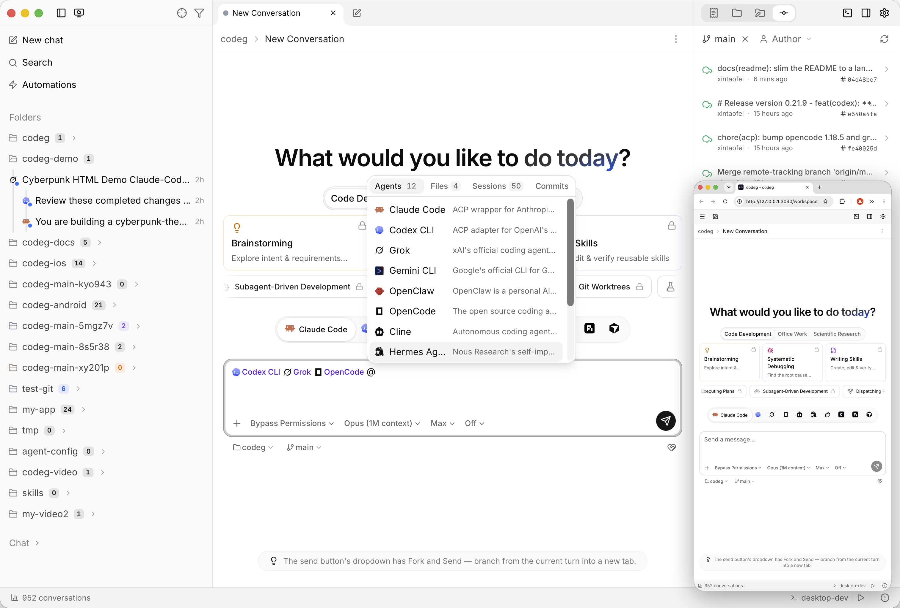

<h1 align="center">
   Codeg, version personnalisée
</h1>

<p align="center">
  <a href="https://github.com/keh4l/codeg/releases/latest"></a>
  <a href="https://github.com/spacering-net/codeg"></a>
  <a href="../../LICENSE"></a>
</p>

<p align="center">
  <sub><a href="../../README.md">简体中文</a> · <a href="./README.en.md">English</a> · <a href="./README.zh-TW.md">繁體中文</a> · <a href="./README.ja.md">日本語</a> · <a href="./README.ko.md">한국어</a> · <a href="./README.es.md">Español</a> · <a href="./README.de.md">Deutsch</a> · <strong>Français</strong> · <a href="./README.pt.md">Português</a> · <a href="./README.ar.md">العربية</a></sub>
</p>

<p align="center">
  <strong><a href="https://github.com/spacering-net/codeg">Codeg</a>, l'espace de travail multi-agents de xintaofei, personnalisé par keh4l</strong><br/>
  Tous vos agents de code IA au même endroit, qui travaillent ensemble. Suit de près le projet d'origine et ajoute quelques fonctionnalités.
</p>

<h3 align="center"><a href="https://github.com/keh4l/codeg/releases/latest"><ins>Télécharger</ins></a> · <a href="#installation"><ins>Installation</ins></a> · <a href="https://docs.codeg.app"><ins>Documentation officielle</ins></a></h3>

<p align="center">
  <picture>
    <source media="(prefers-color-scheme: dark)" srcset="../images/workspace-dark.png" />
    
  </picture>
</p>

## Différences avec la version officielle

<table>
  <tr>
    <td width="50%" valign="top">🪟 <strong>Des onglets par fenêtre</strong><br/>Avec plusieurs fenêtres sur un même serveur, désactivez la synchronisation des onglets et chaque fenêtre garde les siens ; conversations et messages restent synchronisés.</td>
    <td width="50%" valign="top">🌐 <strong>Réponses et messages traduits</strong><br/>Chaque partie d'une réponse de l'agent est traduite dans votre langue dès qu'elle est terminée, raisonnement, cartes de question et listes de tâches compris, et un message passe en anglais d'une touche, grâce aux modèles de traduction d'Alibaba Cloud ou de Tencent Cloud, en une seconde environ pour 1 000 caractères.</td>
  </tr>
  <tr>
    <td width="50%" valign="top">🧩 <strong>Sessions des sous-agents de Claude Code</strong><br/>Les lignes de sous-agent gagnent « Voir la conversation », qui ouvre sa conversation complète comme c'est déjà le cas pour Codex ; un sous-agent se suit pendant qu'il travaille.</td>
    <td width="50%" valign="top">📱 <strong>Changer de conversation ouverte sur téléphone</strong><br/>Sur téléphone, touchez le titre de la conversation pour voir toutes les conversations ouvertes et où en est chacune, puis touchez-en une pour y passer ; le titre vous prévient quand une autre vous attend.</td>
  </tr>
  <tr>
    <td width="50%" valign="top">🎨 <strong>Les agents génèrent des images</strong><br/>Renseignez l'adresse, la clé et les modèles d'OpenAI, de Grok, de Gemini ou d'un relais, et tout agent compatible MCP peut créer et modifier des images et les enregistrer là où il l'indique ; l'image s'affiche dans la conversation, et la clé ne passe jamais par l'agent.</td>
    <td width="50%" valign="top">⏳ <strong>Des résultats même pour les agents au délai court</strong><br/>Certains agents n'attendent que 30 à 60 secondes un appel d'outil. Cette version plafonne chaque attente selon l'agent, répond à temps et récupère la suite à l'appel suivant : une réponse lente à une question ne compte plus comme une absence de réponse.</td>
  </tr>
  <tr>
    <td width="50%" valign="top">🗂️ <strong>Seulement les agents que vous utilisez</strong><br/>Les réglages listent seulement les agents que vous avez ajoutés ; les autres attendent dans « Ajouter des agents », avec recherche et ajout de plusieurs à la fois. Une nouvelle installation n'active que ceux installés ici, et le sélecteur de nouvelle conversation reste court.</td>
    <td width="50%" valign="top">📋 <strong>Appui long pour sélectionner du texte sur un téléphone</strong><br/>Un appui long sur le texte d'une réponse ou de la zone de saisie fait apparaître les poignées de sélection et le menu de copie du téléphone, au lieu du menu de la conversation ; une réponse sélectionnée au doigt affiche Copier le texte / Citer / Demander sous la zone de saisie, à l'écart du menu du téléphone.</td>
  </tr>
  <tr>
    <td width="50%" valign="top">🔁 <strong>Redémarrer le serveur depuis le web</strong><br/>Réglages → Système gagne « Redémarrer codeg » : codeg déployé sur un serveur redémarre sans se connecter au serveur, et la page se reconnecte d'elle-même ; restaurer une sauvegarde sur un serveur redémarre désormais aussi pour l'appliquer.</td>
    <td width="50%" valign="top">⏯️ <strong>Les sous-agents reprennent là où une erreur les a arrêtés</strong><br/>Quand un sous-agent délégué s'arrête parce que le réseau a coupé, que son quota est épuisé, que sa connexion a expiré ou que le fournisseur a renvoyé une erreur, l'agent principal peut le faire continuer dans sa session d'origine, avec son contexte et le travail à moitié fait, au lieu de tout recommencer dans une nouvelle.</td>
  </tr>
  <tr>
    <td width="50%" valign="top">🧭 <strong>Réglages regroupés</strong><br/>La navigation des Réglages est rangée sous cinq titres ; les pages chargées réunissent les options liées sur une seule carte, chaque page a un titre et, sur téléphone, un menu déroulant n'écrase plus sa description.</td>
    <td width="50%" valign="top">↩️ <strong>Les sous-agents réveillent l'agent principal quand ils ont fini</strong><br/>Quand un sous-agent délégué a fini, son résultat revient tout seul à l'agent principal : s'il est libre, un nouveau tour démarre et il poursuit ; s'il est occupé, le résultat arrive dans le tour en cours ; et si vous êtes justement en train d'envoyer un message, il part avec. L'agent principal peut terminer son tour dès qu'il a distribué le travail, sans rester à attendre pour vérifier les résultats.</td>
  </tr>
  <tr>
    <td width="50%" valign="top">🌿 <strong>Les sous-agents travaillent dans leur propre worktree</strong><br/>L'agent principal peut faire modifier le code par un sous-agent dans un worktree et une branche git à part, pour que plusieurs sous-agents en parallèle ne se gênent pas ; chaque délégation peut choisir son modèle et son niveau de raisonnement, et un sous-agent qui a fini peut recevoir du travail en plus dans la même session.</td>
    <td width="50%" valign="top">🗣️ <strong>Intervenir à tout moment</strong><br/>Pendant que l'agent répond, la touche d'envoi glisse votre message dans le tour en cours, et l'agent le lit après l'étape en cours ; avec ⌘/Ctrl, il est mis en attente pour après le tour. On peut intervenir avec tous les agents. La file vit sur le serveur : elle survit à un rechargement et vous suit sur un autre appareil ; un arrêt ou une erreur la met en pause jusqu'à ce que vous repreniez.</td>
  </tr>
  <tr>
    <td width="50%" valign="top">✨ <strong>Vue compacte façon T3</strong><br/>Replie les étapes de chaque réponse en une ligne « A travaillé Xs » et n’affiche que l’étape en cours pendant l’exécution ; remplace les cartes par une arborescence des fichiers modifiés et n’affiche le pied de réponse qu’au survol. Ajoute quatre niveaux d’outils, une minicarte, la recherche ⌘/Ctrl+F sur tout le fil, des citations avec retour à la source, le retour à la ligne et « Lancer dans le terminal » sur le code, et un thème noir pur « Carbone ».</td>
    <td width="50%" valign="top">🛰️ <strong>Accès distant plus réactif</strong><br/>Avec la version web via une IP publique : environ une seconde entre le rechargement et la saisie, le dernier tour d'une longue conversation visible en moins d'une seconde, et plus de « Connexion » en revenant à une conversation que vous venez de voir. Une micro-coupure du réseau se rattrape toute seule : pas d'avis de reconnexion, pas de texte perdu.</td>
  </tr>
  <tr>
    <td width="50%" valign="top">⚡ <strong>Les boutons réagissent tout de suite, les réponses s'affichent à un rythme régulier</strong><br/>Approuver, renommer, supprimer, arrêter et intervenir prennent effet dès le clic. Une requête qui n'est pas passée est relancée et ne s'exécute jamais deux fois ; seul un vrai échec annule le changement, avec un avertissement. Sur une connexion lente, une réponse n'arrive plus par à-coups mais s'affiche à un rythme régulier.</td>
    <td width="50%" valign="top">🏃 <strong>Affiché en cours quand l'agent continue de lui-même</strong><br/>Quand une commande ou un sous-agent en arrière-plan se termine, Claude Code reprend le travail de lui-même, et Codex peut aussi lancer seul son tour suivant. La conversation s'affiche désormais en cours pendant ce temps, avec un bouton Arrêter, et ne passe en revue avec une notification qu'une fois le travail fini ; ce que fait Codex pendant ce tour s'affiche en direct, sans avoir à cliquer sur « Charger l'activité en arrière-plan ».</td>
  </tr>
  <tr>
    <td colspan="2" valign="top">🔄 <strong>Au plus près de l'original</strong><br/>Le projet d'origine est fusionné régulièrement ; ce qui n'est pas listé ici fonctionne comme dans la version officielle. Kiro CLI intégré, le premier ajout de cette version, fait partie de la version officielle depuis la 0.36.0. Les résumés de réflexion de Claude Code passent dès la 0.41.3-1 par l'interrupteur de la version officielle : « Afficher les résumés de réflexion de Claude » dans Réglages → Agents IA → Claude Code, désactivé par défaut. Depuis la 0.46.0-1, le message suivant suggéré se remplit comme dans la version officielle : Tab sur ordinateur, bouton ampoule à côté d’Envoyer sur téléphone. Depuis la 0.49.0, la création et la modification d'assistants passent par les assistants personnels de la version officielle (en langage naturel avec carte de confirmation et annulation).</td>
  </tr>
</table>

<details>
<summary><strong>Des onglets par fenêtre</strong> : détails</summary>
<br/>

- C'est l'interrupteur « Synchroniser les onglets de conversation entre les fenêtres » dans Réglages → Général, activé par défaut : toutes les fenêtres et tous les appareils du serveur (ordinateur, tablette, téléphone) partagent un même ensemble d'onglets ouverts, comme dans la version officielle.
- Désactivé, ouvrir, activer ou fermer un onglet de conversation dans une fenêtre laisse les autres telles quelles, et un rechargement restaure les onglets de cette fenêtre.
- Les conversations, les messages et les suppressions atteignent toujours toutes les fenêtres, quel que soit le réglage.
- Le réglage est enregistré sur le serveur : le changer dans n'importe quelle fenêtre ou sur n'importe quel appareil fait basculer toutes les fenêtres et tous les appareils connectés à ce serveur. (Jusqu'à la 0.35.2-1, il était enregistré par navigateur et désactivé par défaut dans les navigateurs.)
- Demandé en amont dans [spacering-net/codeg#547](https://github.com/spacering-net/codeg/issues/547).

</details>

<details>
<summary><strong>Réponses et messages traduits</strong> : détails</summary>
<br/>

- S'active dans Réglages → Traduction avec une clé d'API de [Alibaba Cloud Bailian](https://bailian.console.aliyun.com/) ou de [Tencent Cloud TokenHub](https://console.cloud.tencent.com/tokenhub/apikey) ; chaque plateforme facture son propre usage. Par défaut, c'est `qwen-mt-flash` de Bailian, qui a pris environ 0,5 s par paragraphe lors des tests.
- Réponses : avec l'interrupteur « Traduction des réponses » activé, chaque partie d'une réponse est traduite dès que l'agent l'a terminée (quand il passe à un outil ou à la réflexion, ou en fin de tour), en entier dans une seule requête pour que le modèle la voie en entier, et s'affiche à la place de l'original ; pendant que l'agent écrit, vous voyez l'original. Le bouton de traduction sous chaque réponse revient à l'original ou, si la traduction automatique est désactivée, traduit cette seule réponse. Le raisonnement est traduit quand vous le dépliez (le titre d'une ligne, visible même replié, reste en langue d'origine) et suit le même bouton ; les blocs de code et les appels d'outils ne sont pas traduits. Le bouton de copie copie ce qui est affiché.
- Noms de session : avec la traduction automatique des réponses, les noms que l'agent donne aux sessions s'affichent aussi dans votre langue, dans la barre latérale, les onglets et l'en-tête de la conversation. Un nom que vous avez choisi reste tel quel, et survoler une session dans la barre latérale montre l'original.
- Cartes de question : quand un agent vous pose une question, la question et ses options s'affichent traduites par défaut (désactivable dans Réglages → Traduction), et le bouton en haut à droite de la carte bascule entre original et traduction ; la réponse désigne toujours l'option de l'agent. Une réponse saisie dans « Autre » se traduit dans la langue cible avec le bouton à côté ou `⌘⇧L`, et le même bouton la rétablit ; avec « Traduire à l'envoi » activé, elle est traduite à l'envoi. Les questions marquées secrètes ne sont jamais envoyées à la traduction.
- Listes de tâches : les étapes de la liste de tâches d'un agent (la ligne « Plan mis à jour » dans une réponse, le plan flottant au-dessus de la conversation et le plan dans les Détails de la session) s'affichent traduites par défaut, toute la liste en une seule requête (désactivable avec « Traduire les listes de tâches automatiquement » dans Réglages → Traduction). Le bouton sous la liste, une fois cette ligne dépliée (dans sa barre de titre pour le plan flottant), bascule entre original et traduction ; interrupteur coupé, le même bouton traduit à la demande.
- Messages : le bouton de traduction de la zone de saisie, `⌘⇧L` (`Ctrl+Maj+L` sous Windows et Linux) ou le menu contextuel traduisent la zone sur place dans la langue cible (l'anglais par défaut). Mentions, commandes slash, chemins et code restent tels quels, et `⌘Z` rétablit l'original en une fois. Rien n'est envoyé à la traduction avant que vous la demandiez : un brouillon inachevé ne quitte jamais la machine. « Traduire à l'envoi » le fait à chaque envoi. Une fois envoyé, le bouton de traduction à côté du message réaffiche ce que vous avez écrit avant de traduire, et la copie suit ce qui est affiché.
- En cas de limite de requêtes, il bascule sur `qwen-mt-lite` ou sur l'autre moteur ; un glossaire fixe la traduction de certains termes, et une entrée sans traduction garde son terme tel quel.
- Les clés d'API sont conservées dans le trousseau du système (sur un serveur, dans `tokens.json` du répertoire de données), jamais dans la base de données ; le bouton en forme d'œil dans les réglages affiche une clé enregistrée. Les requêtes de traduction se connectent directement, sans proxy, et ne passent par le proxy que si le réseau n'autorise rien d'autre.
- La traduction des réponses ne sert qu'à l'affichage : l'historique de la conversation garde le texte original de l'agent. Ce que vous avez écrit avant de traduire un message est gardé dans la base de données locale, et vider le cache de traduction ne l'efface pas.

</details>

<details>
<summary><strong>Sessions des sous-agents de Claude Code</strong> : détails</summary>
<br/>

- Claude Code enregistre toute la conversation de chaque sous-agent (outil Agent / Task) dans un fichier à part, `~/.claude/projects/<projet>/<id de session>/subagents/agent-<id>.jsonl`. Dans la version officielle, la ligne du sous-agent ne montre qu'un résumé de son déroulement et le résultat final (pas même le résumé pour un sous-agent en arrière-plan), et ce fichier ne peut pas être ouvert.
- Cette version ajoute à la ligne du sous-agent un lien « Voir la conversation ↗ » qui ouvre ce fichier dans un panneau latéral : la tâche reçue, son raisonnement et ses réponses, et chaque appel d'outil avec son entrée et sa sortie. C'est le même lien que sur les lignes de sous-agent de Codex et de Grok.
- Le lien apparaît dès le lancement du sous-agent, au premier plan comme en arrière-plan. Ouvert pendant qu'il travaille encore, le panneau se rafraîchit toutes les 2 secondes et affiche comme en cours l'appel d'outil qui s'exécute. Ouvert après un rechargement de la conversation, il montre le fichier tel qu'il était alors ; fermez-le et rouvrez-le pour voir la suite.
- Les conversations plus anciennes en profitent aussi, tant que le fichier du sous-agent existe encore.

</details>

<details>
<summary><strong>Changer de conversation ouverte sur téléphone</strong> : détails</summary>
<br/>

- Sous 768 px de large (un téléphone ou une fenêtre de navigateur très étroite), la version officielle n'affiche pas la barre d'onglets de conversation. Pour atteindre une autre conversation ouverte, il faut la chercher dans tout l'historique de la barre latérale, et une conversation terminée, que la barre latérale masque par défaut, est inaccessible.
- Cette version fait du titre de la conversation un bouton : après le titre viennent ⌄ et le nombre de conversations ouvertes, avec un point orange sur le nombre tant qu'une autre conversation attend votre accord ou votre réponse. Il ouvre par le bas « Conversations ouvertes » : toutes les conversations ouvertes dans l'ordre des onglets, chacune avec son état (Vous attend, En cours, Revue, Terminé, Annulé, Non envoyé). Touchez-en une pour y passer, × pour la fermer ; vous pouvez aussi démarrer une nouvelle conversation ou ouvrir la barre latérale avec « Toutes les conversations (historique compris) ». On le ferme en touchant à côté, en le tirant vers le bas ou avec le geste retour.
- « Vous attend » n'est connu que si cet appareil est connecté à la conversation : il s'affiche pour les conversations ouvertes au moins une fois sur cet appareil, les autres montrent leur état enregistré.
- Avec « Synchroniser les onglets de conversation entre les fenêtres » activé (par défaut), une conversation fermée sur le téléphone se ferme aussi sur l'ordinateur, comme si l'on fermait son onglet là-bas.
- À partir de 768 px de large (ordinateurs, tablettes), rien ne change : la barre d'onglets reste.
- Une conversation ouverte depuis la barre latérale est d'abord un aperçu (comme sur le bureau) que la suivante ouverte remplace ; ici son titre est en italique, et le 📌 à côté la garde ouverte. Un double toucher dans la barre latérale la garde aussi, comme un double clic sur le bureau : sur un téléphone, la barre latérale attend maintenant un instant avant de se fermer, pour que le second toucher tombe sur la même ligne.
- Demandé dans [keh4l/codeg#10](https://github.com/keh4l/codeg/issues/10), [#12](https://github.com/keh4l/codeg/issues/12).

</details>

<details>
<summary><strong>Les agents génèrent des images</strong> : détails</summary>
<br/>

- Dans Paramètres → Génération d'images, ajoutez un service : choisissez API OpenAI (OpenAI, Grok et la plupart des relais) ou API Gemini (Google ou un relais), laissez l'adresse vide pour l'adresse officielle, puis ajoutez la clé et des noms de modèle comme `gpt-image-2`, `grok-imagine-image-2.0` ou `gemini-3-pro-image`. Vous pouvez en ajouter plusieurs. Tester génère une petite image de faible qualité pour vérifier que tout fonctionne ; elle est facturée par le service.
- Une fois l'interrupteur en haut de la page activé (le même que « Générer des images » dans Paramètres → Collaboration → Outils dans la conversation, désactivé par défaut) et au moins un service doté d'une clé et d'un modèle, les agents lancés ensuite reçoivent deux outils, `image_generate` et `image_get_result`. Un agent peut choisir le modèle, le format, la résolution et un fond transparent, et transmettre des images de référence pour modifier une image existante ; sans modèle, c'est celui par défaut des paramètres.
- L'agent décide où l'image est enregistrée ; un chemin relatif part du dossier de travail de la conversation. Sans chemin, les images vont dans `~/.codeg/generated-images/<date>/`, un dossier modifiable dans les paramètres.
- Chaque image a sa carte dans la conversation : pendant la génération, les secondes écoulées ; ensuite l'image, l'endroit où elle a été enregistrée (clic pour l'ouvrir), le service et le modèle, la taille et la durée. L'image est lue depuis le fichier : après un rechargement de la conversation, elle reste visible tant que le fichier existe.
- Par défaut l'agent reçoit aussi une copie d'environ 512 pixels de large, pour voir le résultat avant de décider s'il le modifie ; cela consomme un peu de son contexte. Désactivez-le dans les paramètres si le modèle de l'agent ne sait pas lire les images.
- Une image prend souvent de quelques dizaines de secondes à deux minutes. Quand c'est plus long que ce que l'agent peut attendre pour un appel d'outil, il reçoit d'abord un identifiant de tâche et récupère l'image avec `image_get_result` ; voir la section suivante.
- C'est Codeg qui fait l'appel ; l'agent ne reçoit que le fichier image. Les clés d'API sont conservées dans le trousseau du système (dans la version serveur, dans `tokens.json` du dossier de données), pas dans la base de données, et ne font pas partie de la synchronisation de la configuration.

</details>

<details>
<summary><strong>Des résultats même pour les agents au délai court</strong> : détails</summary>
<br/>

- Le temps qu'un agent attend un appel d'outil MCP varie : ZCode 30 secondes ; Cursor et Kimi 60 secondes ; Codex 5 minutes ; Claude Code, OpenCode, Qoder, CodeBuddy, Grok et, depuis la 0.12, DeepSeek pratiquement sans limite. Dans la version officielle, `get_delegation_status` (attendre le résultat d'une tâche déléguée) peut attendre longtemps en un seul appel et `ask_user_question` (une question pour vous) attend votre réponse ; passé le délai, l'agent considère l'appel comme échoué et continue, si bien que la question compte comme restée sans réponse.
- Cette version donne à ces outils un plafond par agent, inférieur à son délai : par exemple 20 secondes sur ZCode, 45 secondes sur Cursor, 4 minutes sur Codex ; les agents sans limite n'ont pas de plafond, comme dans la version officielle. Plafond atteint sans résultat, l'appel revient et indique à l'agent comment continuer d'attendre.
- Questions : si vous n'avez pas encore répondu, la carte de la question reste en place et l'agent continue d'attendre avec un nouvel outil, `get_question_answer` ; une fois votre réponse donnée, elle s'affiche dans la carte d'origine.
- Dans « N en cours », chaque sous-agent a un bouton « Arrêter », et l’en-tête affiche « Tout arrêter » quand il y en a deux ou plus. Le résultat d’un sous-agent arrêté là n’est pas renvoyé à l’agent principal.
- Tâches déléguées : un appel à `get_delegation_status` attend au plus jusqu'au plafond, puis renvoie l'état actuel des tâches. Avec « Réveiller l’agent principal quand un sous-agent termine » activé, l'agent principal n'a en général plus besoin d'attendre : les résultats lui reviennent d'eux-mêmes ; voir « Les sous-agents réveillent l'agent principal quand ils ont fini ». La génération d'images fonctionne de la même façon ; voir la section précédente.
- Pendant l'attente, l'agent reçoit un point d'avancement toutes les 10 secondes, ce qui permet aux agents qui prolongent leur délai selon l'avancement, comme CommandCode, d'attendre plus longtemps.

</details>

<details>
<summary><strong>Seulement les agents que vous utilisez</strong> : détails</summary>
<br/>

- Il y a 20 agents intégrés, et la version officielle les active tous, installés ou non : une longue liste dans les réglages, un sélecteur de nouvelle conversation rempli d'agents non installés (la page de conversation n'en installe jamais, les choisir ne mène à rien) et une vérification de chacun à chaque ouverture de la page des réglages.
- Dans cette version, Réglages → Agents IA ne liste que « Mes agents », toujours réordonnables par glisser-déposer. « Ajouter » dans la barre de titre et la ligne sous la liste ouvrent « Ajouter des agents » : recherche par nom ou description, filtre installés / non installés, agents déjà installés ici en premier, ajout de plusieurs à la fois. Un agent non installé s'installe depuis ses détails une fois ajouté.
- L'interrupteur dans les détails d'un agent, c'est « Mes agents » : désactivez-le pour retirer l'agent de la liste, avec annulation possible. C'est le réglage « activé » de la version officielle, donc le sélecteur de nouvelle conversation, la délégation et tout le reste le suivent.
- À l'ouverture de la page des réglages, seuls « Mes agents » sont vérifiés ; tout autre agent l'est quand vous l'ouvrez.
- Tant que codeg n'a pas encore de réglages pour un agent (nouvelle installation, ou agent intégré ajouté par une version ultérieure), il ne l'active que s'il le détecte comme installé ici. Pour codeg, un agent est installé dès que l'adaptateur ACP ou la CLI qu'il lance est en place ; une nouvelle installation n'en a donc souvent aucun et la liste démarre vide : choisissez dans « Ajouter des agents ». Un agent installé plus tard n'est pas ajouté tout seul, et les réglages existants ne changent jamais.
- Après une mise à jour depuis une version antérieure avec des agents non installés dans « Mes agents », un message en haut de la liste propose une fois de « garder seulement les installés » ou de laisser tel quel (le choix est mémorisé par appareil).
- Le sélecteur de nouvelle conversation termine sa ligne par un « + » qui ouvre « Ajouter des agents » ; quand tous les agents ne tiennent pas, il est en bas du menu « plus ». Sans agent activé, le bouton du sélecteur ouvre aussi « Ajouter des agents ».

</details>

<details>
<summary><strong>Appui long pour sélectionner du texte sur un téléphone</strong> : détails</summary>
<br/>

- Dans la version officielle, toute la zone de conversation et la zone de saisie ont leurs propres menus contextuels, et un appui long du doigt les ouvre aussi : en maintenant une réponse environ 0,7 s, le menu de la conversation (Nouvelle conversation, Exporter la conversation…) apparaît ; sous Android, l'événement envoyé par l'appui long est en plus annulé, ce qui annule la sélection de mot du téléphone. En HTTPS, un appui long dans la zone de saisie ouvre son propre menu Couper / Copier / Tout sélectionner. Les poignées de sélection et le menu de copie du téléphone n'apparaissent jamais, si bien que copier le texte des réponses et de la zone de saisie est difficile.
- Cette version laisse l'appui long du doigt ou du stylet au téléphone : sélectionner, faire glisser les poignées, copier et coller sont ceux du téléphone. Un clic droit à la souris ouvre toujours les deux menus, y compris sur un ordinateur à écran tactile.
- Dans la version officielle, la bulle Copier le texte / Citer / Demander d'une réponse sélectionnée se place à côté de la sélection, tout comme le menu du téléphone, au-dessus ou en dessous selon ce que décide le téléphone ; une page ne peut ni lire sa position ni le déplacer, si bien que les deux se superposent souvent. Dans cette version, une sélection faite au doigt place ces boutons et le nombre de caractères sélectionnés sous la zone de saisie, à la place de la ligne dossier et branche jusqu'à ce que la sélection disparaisse ; le menu du téléphone ne va pas au-delà de la zone de saisie. Demander reçoit la question directement dans cette ligne. Une sélection faite à la souris affiche toujours la bulle au-dessus.
- Les Messages rapides du menu de la zone de saisie se trouvent aussi sous le « + » en bas à gauche de la zone ; la traduction d'un message a son propre bouton.
- Sur iOS, le menu système du texte ordinaire d'une page web n'a pas de « Tout sélectionner » (seuls les champs de texte l'ont) ; pour copier une réponse entière, utilisez le bouton de copie situé dessous.

</details>

<details>
<summary><strong>Redémarrer le serveur depuis le web</strong> : détails</summary>
<br/>

- Déployée sur un serveur, la version officielle n'offre aucun moyen de redémarrer codeg depuis la page web : après avoir changé un réglage qui demande un redémarrage (apparence, langue, liste des fournisseurs, proxy du navigateur…), ou quand le service se comporte mal, il faut se connecter au serveur pour le redémarrer. Restaurer une sauvegarde sur un serveur, c'est pareil : la restauration ne s'applique qu'après un redémarrage, mais le redémarrage qu'elle appelle n'accepte qu'une mise à jour préparée, et se termine donc toujours par « le service n'a pas pu redémarrer, redémarrez-le manuellement ».
- Cette version ajoute « Redémarrer codeg » sous « Mise à jour logicielle » dans Réglages → Système. « Redémarrer » demande d'abord confirmation, et la boîte de dialogue indique combien de conversations sont en cours et seront interrompues ; ensuite il fait un décompte, attend le retour du service et recharge la page. Les autres fenêtres ouvertes affichent aussi « Redémarrage » dans leur barre d'état.
- Il redémarre comme une mise à jour sur place : sous Docker ou le superviseur (`--supervise`), le superviseur le relance après `CODEG_RESTART_DELAY_MS` ; lancé seul, le processus redémarre sur place (systemd et consorts voient toujours le même processus). Un redémarrage simple n'entre pas dans la période d'essai de la mise à jour et ne déclenche jamais son retour automatique en arrière. Impossible de redémarrer pendant qu'une mise à jour se télécharge ou s'installe.
- Après la restauration d'une sauvegarde sur un serveur, « Redémarrer maintenant » dans le panneau de résultat utilise le même redémarrage, si bien que la restauration s'applique d'elle-même.
- Versions serveur uniquement : absent de l'application de bureau et d'un navigateur connecté au service web intégré d'une application de bureau ; comme la mise à jour sur place, pas encore sur les serveurs Windows.

</details>

<details>
<summary><strong>Les sous-agents reprennent là où une erreur les a arrêtés</strong> : détails</summary>
<br/>

- Quand vous mentionnez un agent avec @ dans un message, l'agent principal lui confie le travail avec `delegate_to_agent`, et il le fait dans sa propre sous-session. Dans la version officielle, `resume_delegation` ne récupère que les sous-tâches annulées ou interrompues par un plantage ; si le tour du sous-agent se termine par une erreur (réseau coupé, quota ou limite de débit atteint, connexion expirée, requête refusée par le fournisseur, budget de tokens épuisé…), il est marqué « échoué », et l'agent principal ne peut qu'ouvrir une nouvelle sous-session et repartir de zéro, en perdant le contexte du travail à moitié fait.
- Cette version traite aussi ces échecs comme des interruptions : le résultat de la sous-tâche indique que sa session et le travail partiel sont conservés et que `resume_delegation` la poursuit une fois la cause réglée. L'agent principal continue alors dans la sous-session d'origine, avec le même task_id, et la carte d'origine du sous-agent dans la conversation affiche de nouveau sa progression.
- Pour s'en servir : une fois le réseau revenu, le quota rechargé ou la connexion renouvelée, demandez à l'agent principal de laisser le sous-agent continuer.
- Une tâche qui a échoué avant d'avoir une session (l'agent n'a pas pu démarrer, par exemple) n'a rien à poursuivre et doit être déléguée à nouveau. Pour ajouter du travail à une sous-tâche terminée, on utilise `continue_delegation` ; voir « Les sous-agents travaillent dans leur propre worktree ».

</details>

<details>
<summary><strong>Réglages regroupés</strong> : détails</summary>
<br/>

- La navigation est regroupée sous cinq titres (Essentiel, Agents, Contenu, Contrôle, Connexions et maintenance) ; les pages et leur ordre sont ceux de la version officielle.
- Apparence, Général, Système, Contrôle de version et Traduction réunissent les réglages liés sur une carte surmontée du nom du groupe, et un réglage à un seul interrupteur ou menu tient sur une ligne : nom et description à gauche, contrôle à droite. Apparence passe de douze cartes à trois groupes ; dans Contrôle de version, « Ajouter un compte » passe dans l'en-tête de chaque section.
- Chaque page commence par un titre et une description d'une ligne ; l'interrupteur du proxy est comme les autres ; sur téléphone, un menu ou bouton qui ne tient pas passe sous sa description ; dans une large fenêtre de navigateur, les pages de formulaire sont limitées en largeur et centrées.

</details>

<details>
<summary><strong>Les sous-agents réveillent l'agent principal quand ils ont fini</strong> : détails</summary>
<br/>

- Dans la version officielle, une fois un sous-agent envoyé, l'agent principal ne connaît le résultat qu'en allant le chercher lui-même avec `get_delegation_status` : soit il attend en bloquant, soit il vérifie de temps en temps. Dès qu'il termine son tour, personne ne le prévient quand le sous-agent a fini ; il faut que vous lui envoyiez un nouveau message pour qu'il pense à vérifier.
- Cette version renvoie le résultat à l'agent principal quand un sous-agent a fini (ou s'arrête en route sur une erreur) :
  - Agent principal libre : au bout de 2 secondes (ceux qui finissent en même temps sont regroupés), un nouveau tour démarre tout seul et l'agent principal poursuit à partir des résultats ;
  - Agent principal en plein tour : Claude Code, Codex, Grok, Kiro et Antigravity les reçoivent directement dans ce tour, les autres agents dans un nouveau tour qui démarre tout seul une fois celui-ci terminé ;
  - Vous êtes justement en train d'envoyer un message : les résultats partent avec.
- La conversation affiche une ligne « Résultats des sous-tâches rendus » qui indique chaque sous-agent, s'il a fini ou échoué et combien de temps il a pris ; dépliée, elle montre un résumé de chaque résultat et « Ouvrir la session ». Ceux qui sont partis avec votre message s'affichent dessous sous la forme « N résultats de sous-tâches joints ». Cette ligne est envoyée par codeg à l'agent principal : elle n'est pas relayée aux canaux de chat comme si vous l'aviez dite, et ne sert pas à nommer la session.
- Les résultats que l'agent principal a déjà récupérés lui-même avec `get_delegation_status` ou `cancel_delegation` ne sont pas renvoyés ; les sous-tâches annulées par l'agent principal ou par vous ne sont pas envoyées.
- Un clic sur Arrêter n'arrête que le tour de l'agent principal ; ses sous-agents en cours continuent de travailler, comme dans la version officielle (depuis la 0.50.0, interrompre l'agent principal n'arrête plus ses sous-agents). Pour arrêter des sous-agents, utilisez « Arrêter » ou « Tout arrêter » dans « N en cours ». Après que vous avez arrêté l'agent principal, après un tour qui se termine par une erreur (limite de débit, réseau coupé…) et après 20 reprises automatiques d'affilée, aucun nouveau tour ne démarre tout seul : les résultats des sous-agents (y compris ceux terminés mais pas encore remis) attendent votre message suivant, ce qu'indique une mention à côté de « N en cours ».
- L'interrupteur est « Réveiller l’agent principal quand un sous-agent termine » dans Réglages → Collaboration → Collaboration multi-agent → Général, activé par défaut, et s'applique aux sessions lancées ensuite ; désactivé, c'est comme dans la version officielle : l'agent principal doit aller voir lui-même.

</details>

<details>
<summary><strong>Les sous-agents travaillent dans leur propre worktree</strong> : détails</summary>
<br/>

- Dans la version officielle, tous les sous-agents travaillent dans le dossier de travail de l'agent principal : deux sous-agents envoyés en même temps pour modifier du code touchent aux mêmes fichiers ; le modèle est fixé d'avance dans l'assistant @ ou les Réglages, sans que l'agent principal puisse le choisir selon la tâche ; et pour retoucher quelque chose une fois le sous-agent terminé, il faut ouvrir une nouvelle session et tout réexpliquer.
- Cette version ajoute trois paramètres à `delegate_to_agent` :
  - `isolation: "worktree"` : le sous-agent travaille dans un nouveau worktree git, sur la branche `delegate/<id>`, créé à partir du commit où se trouve l'agent principal ; les modifications non commitées de l'agent principal n'y sont pas, et la réponse à la délégation le rappelle. Le worktree va là où pointe « Emplacement du worktree » dans les « Tâches à faire » (à côté du dépôt si rien n'est défini), dans un dossier nommé `<dépôt>-delegate-<id>`. Quand le sous-agent a fini, son résultat donne le chemin, la branche et ce qui a changé ; l'agent principal le relit puis fusionne avec git, ou vous le laisse. Ne fonctionne que dans un dépôt git qui a au moins un commit.
  - `model` et `config` : un modèle et des options pour cette seule délégation (par exemple `{"reasoning_effort": "high"}`), appliqués par-dessus les valeurs par défaut de l'assistant @ ou des Réglages ; les options non précisées restent inchangées. Au démarrage du sous-agent, ils sont vérifiés par rapport aux options qu'il propose réellement : si l'une ne correspond pas, il n'est pas autorisé à commencer et l'agent principal apprend ce qui est disponible ; les options qu'il n'a pas du tout sont ignorées, et la réponse le signale.
- Nouvel outil `continue_delegation` : donne du travail en plus à une sous-tâche terminée (achevée, échouée ou annulée), dans sa sous-session d'origine, en gardant le contexte, le dossier de travail, le modèle et les options ; le résultat revient lui aussi à l'agent principal. Chaque ajout compte comme un nouveau tour, avec un nouveau task_id. Partage des rôles avec `resume_delegation` : resume reprend un travail interrompu en route, continue en demande plus une fois qu'il est fini.
- La ligne de la délégation porte après son titre des étiquettes pour le modèle, la branche et « Tour N » ; dépliée, elle montre le modèle, les options et l'état du worktree (le commit dont il part, le nombre de fichiers modifiés). « Ouvrir » ouvre le worktree dans l'espace de travail (relire les modifications, commiter et fusionner se font là), et « Supprimer le worktree » le supprime, branche comprise si vous le voulez.
- Les worktrees ne sont pas supprimés automatiquement. Quand vous supprimez une sous-session qui en a utilisé un, la boîte de confirmation propose en plus « Supprimer aussi son worktree » ; s'il contient des modifications non commitées, la case est décochée par défaut et leur nombre est indiqué.

</details>

<details>
<summary><strong>Intervenir à tout moment</strong> : détails</summary>
<br/>

- Dans la version officielle, Entrée met le message en attente pendant que l'agent répond ; l'intervention se cache derrière la petite flèche à côté d'Envoyer et n'entre directement dans le tour qu'avec Claude Code et Codex. Les autres agents demandent d'activer « Retour en direct » dans les réglages et ne reçoivent qu'une note qu'ils liront peut-être en la consultant. La file vit dans le navigateur courant et disparaît au rechargement, et après un arrêt le message suivant part aussitôt.
- Cette version suit T3 Code :
  - Le bouton d'envoi : Arrêter quand la zone de saisie est vide ; avec du contenu, l'icône indique ce que fait un clic — intervenir (↱) ou mettre en attente (liste +). En maintenant ⌘/Ctrl l'icône bascule, et ⌘/Ctrl-clic fait l'autre ; sur téléphone, un appui long sur Envoyer choisit l'autre pour ce message.
  - Intervenir est le comportement par défaut ; « Envoyer pendant que l'agent répond » dans Réglages → Général → Onglets et saisie passe à la file d'attente, sur cet appareil seulement.
  - Touches (modifiables dans Réglages → Raccourcis) : Entrée envoie de la façon par défaut ; ⌘/Ctrl+Entrée de l'autre ; ⌘/Ctrl+Maj+Entrée fait intervenir le plus ancien message en attente ; Alt+↑ avec le curseur au début de la zone de saisie modifie le dernier en attente.
  - Les commandes slash sont toujours mises en attente, de même qu'une intervention pendant que l'agent compacte son contexte.
- Comment arrive une intervention : Claude Code, Codex, Grok, Kiro (texte seul) et Antigravity 1.5.0+ la prennent dans le tour en cours et la lisent après l'étape en cours. Pour tout autre agent, le tour est arrêté puis relancé dans la même session avec votre message : la réponse coupée se replie en « Tentative interrompue par une intervention », l'étape en cours est perdue et les sous-agents délégués continuent. Grok sans intervention native ne fait que mettre en attente (son annulation arrête aussi l'outil en cours).
- Un message d'intervention est marqué « Intervention », et « Intervention · en attente de lecture » tant qu'il est en route ; les marques survivent à un rechargement.
- La file vit sur le serveur : toutes les fenêtres et tous les appareils voient la même, et elle survit aux rechargements et redémarrages. Sur ordinateur, elle s'affiche en bulles pointillées à la fin de la conversation, sur téléphone au-dessus de la zone de saisie ; chaque message peut être envoyé tout de suite (dans le tour en cours, ou comme nouveau tour au repos), modifié, retiré et réordonné par glisser. Le serveur envoie le suivant quand un tour se termine normalement, même si tous les navigateurs sont fermés, avec les résultats de sous-tâches pas encore livrés.
- Un arrêt, un tour qui finit en erreur (limite de débit, réseau…) ou un redémarrage du serveur met la file en pause : « File en pause » et « Reprendre » s'affichent au-dessus de la zone de saisie ; Reprendre, Entrée dans une zone vide ou un nouveau message la relancent. Une intervention encore en route au moment de l'arrêt est signalée comme non transmise, avec un bouton pour la remettre dans la zone de saisie.
- Le « Retour en direct » (notes) de la version officielle a disparu : plus d'interrupteur dans les réglages, et les agents ne reçoivent plus l'outil `check_user_feedback`.

</details>

<details>
<summary>Détails de <strong>Vue compacte façon T3</strong></summary>
<br/>

- <strong>Activée par défaut, réversible</strong> : basculez instantanément entre « Compact (style T3) » et « Chronologie (classique) » dans Paramètres → Apparence → Style de conversation (local à l’appareil).
- <strong>Ligne en direct et pliage auto</strong> : pendant que l’agent travaille, « Au travail depuis Xs » est une ligne de minuterie traversée par un reflet ; chaque groupe d’outils terminé tient en une ligne de résumé (« A lu 2 fichiers, a cherché une fois »), le texte intermédiaire reste en place et l’étape en cours a sa propre ligne scintillante — un clic ouvre ce groupe. À la fin, la même ligne devient sur place « A travaillé Xs › » et tout ce qui précède la réponse se replie dessous ; à l’ouverture, on retrouve ces lignes de résumé, et chaque groupe montre ses étapes dans une petite zone qui défile seule, estompée aux bords. Ouvrir ou fermer laisse la ligne cliquée à sa place. Les échecs non résolus, autorisations en attente, questions, plans, sous-agents actifs et images générées restent toujours hors du pli ; un tour ouvert pendant l’exécution reste ouvert.
- <strong>Quatre niveaux d’appels d’outils</strong> : Tout afficher, Masquer les réussis, Tout masquer et Mode zen dans les Paramètres ou le menu « … » de l’en-tête.
- <strong>Arborescence des fichiers &amp; diff</strong> : dossiers uniques fusionnés, déplié jusqu’à 8 fichiers, virtualisé au-delà de 250 lignes ; un clic ouvre le panneau de diff, les nouveaux HTML/Markdown/images s’affichent en aperçu intégré, et chaque ligne d’édition propose aussi l’ouverture du diff.
- <strong>Bulles groupées et pied au survol</strong> : messages consécutifs regroupés, collage d’images intégré à la bulle, pliage au-delà de 22rem, heure, copie et édition en ligne avec renvoi de la version officielle au survol (sur les agents prenant en charge le retour arrière). Le pied de réponse apparaît au survol (toujours visible sur la dernière réponse) ; vitesse tok/s masquée par défaut. L’envoi ancre votre message à 24px du haut.
- <strong>Minicarte, recherche complète, citations &amp; Carbone</strong> : minicarte sur ordinateur, ⌘/Ctrl+F sur tout l’historique (y compris les tours non chargés, avec dépliage automatique), citations cliquables avec surbrillance 2s sur l’original, retour à la ligne et collage sans exécution dans un nouveau terminal pour les blocs shell, et thème noir pur « Carbone ».

</details>

<details>
<summary><strong>Accès distant plus réactif</strong> : détails</summary>
<br/>

- Sur une liaison publique à forte latence et avec perte de paquets, la version officielle est lente : le texte en streaming part en une trame WebSocket par petit morceau, et chaque trame attend l'accusé de réception de la précédente (Nagle), si bien que le texte arrive par paquets toutes les demi-secondes. Un seul paquet perdu suffit pour que le contrôle de congestion par défaut divise par deux le débit d'envoi, et les 1,9 MB de scripts du premier chargement prennent plus de vingt secondes. Une reconnexion retélécharge tout l'instantané de la conversation. Les captures d'écran sont intégrées à la conversation en base64 et envoyées en entier à chaque ouverture. À l'ouverture d'une conversation, le serveur analyse trois fois le même journal. Quitter une conversation déconnecte son agent, donc y revenir reconnecte et recharge tout.
- Ce qu'obtient cette version (liaison simulée : 368 ms aller-retour, 7 % de perte de paquets, agent scripté ; une conversation de 150 tours avec 10 captures d'écran) :

  |  | Version officielle | Cette version |
  | --- | --- | --- |
  | De la première ouverture à la saisie | 24,8 s | 8–14 s |
  | Du rechargement à la saisie | 2,7 s | 1,1–1,2 s |
  | De l'ouverture d'une longue conversation à son dernier tour | 12,3 s | 0,8 s |
  | Retour à une conversation que vous venez de voir | 6,3 s (recharge tout) | 0,2 s |
  | Écart entre deux mises à jour du texte pendant une réponse (médiane / 95ᵉ centile) | 366 / 460–731 ms | 34–38 / 66–100 ms |

- Connexion : le serveur désactive Nagle et utilise le contrôle de congestion BBR (une perte de paquet n'est plus prise pour de la congestion), et garde petite la file de données non envoyées du noyau, pour qu'un signal de vie n'attende jamais derrière un gros bloc. Le WebSocket gagne le sous-protocole `codeg-events.v2` : le texte en streaming est regroupé en une trame toutes les 100 ms, et les grosses trames sont compressées et découpées. La page vérifie toutes les 5 secondes et ne considère la connexion perdue qu'après 15 secondes de silence ; elle se reconnecte alors aussitôt et ne reçoit que les événements manqués. Une reprise en moins de 8 secondes n'affiche aucun avertissement, et une coupure de 3 ou 8 secondes ne demande même pas de reconnexion. L'application de bureau connectée à un serveur distant utilise aussi la v2.
- Ouverture d'une conversation : les captures d'écran se chargent à part, à la demande, d'abord en miniature, et ne sont plus retéléchargées une fois vues. Une sortie d'outil de plus de 24 KB n'arrive d'abord qu'avec son début et sa fin, et le texte complet est récupéré quand vous la dépliez. Le premier écran ne récupère que les derniers tours, selon leur taille. Le serveur met en cache les conversations Claude Code déjà analysées et ne les réanalyse que si le journal change.
- Changement de conversation : quitter une conversation met son agent de côté au lieu de le déconnecter, et y revenir le reprend directement. Appuyer sur une conversation de la barre latérale ou la survoler lance déjà sa récupération. Les agents mis de côté occupent de la mémoire, donc le serveur en garde au plus 6 inactifs et déconnecte au-delà ceux qui sont inutilisés depuis le plus longtemps.
- Démarrage : les fichiers statiques avec hachage sont mis en cache durablement ; un rechargement mène directement à l'espace de travail ; les 20 requêtes du démarrage sont regroupées en une seule, envoyée avant la fin du téléchargement des scripts de la page.
- Variables d'environnement du serveur (rarement utiles) :

  | Variable | Défaut | Rôle |
  | --- | --- | --- |
  | `CODEG_WS_COALESCE_MS` | `100` | Fenêtre de regroupement du texte en streaming en une trame (ms, 1000 au plus ; `0` désactive le regroupement) |
  | `CODEG_TCP_CONGESTION` | `bbr` | Contrôle de congestion des connexions web ; celui du système si le noyau ne l'a pas ; vide ou `off` ne change rien |
  | `CODEG_TCP_NOTSENT_LOWAT` | `65536` | Nombre maximal d'octets non envoyés que le noyau garde par connexion ; `0` pour aucune limite |
  | `CODEG_ACP_MAX_IDLE_CONNECTIONS` | `6` | Nombre d'agents mis de côté inactifs à garder ; `0` pour aucune limite (les inactifs restent libérés au bout d'un certain temps) |
  | `CODEG_ACP_IDLE_HOLD_GRACE_SECS` | `90` | Secondes sans activité avant qu'un agent mis de côté compte comme inactif |
  | `CODEG_DETAIL_CACHE_ENTRIES` | `6` | Nombre de conversations Claude Code analysées à garder en cache ; `0` désactive le cache |

</details>

<details>
<summary><strong>Les boutons réagissent tout de suite, les réponses s'affichent à un rythme régulier</strong> : détails</summary>
<br/>

- Dans la version officielle, chaque bouton attend la réponse du serveur : avec 368 ms d'aller-retour, la carte d'une autorisation approuvée met 0,4 s à disparaître, renommer et supprimer prennent une demi-seconde, et Arrêter ne montre pas que le clic a été pris en compte. Une requête perdue en route échoue tout simplement. Quand le réseau hoquette, les réponses arrivent par à-coups.
- Cette version :
  - Renommer, supprimer, épingler, changer le statut, la couleur, l'alias et l'agent par défaut d'un dossier, retirer un dossier de l'espace de travail, approuver des autorisations, répondre aux questions et approuver des plans : le changement est fait localement et s'affiche dès le clic. Si le serveur refuse et que l'écran montre encore votre changement, il est annulé avec un avertissement ; un modèle ou une option qui n'a pas été appliqué revient aussi à sa valeur précédente.
  - Leurs requêtes sont relancées jusqu'à deux fois en cas d'erreur réseau. Les requêtes qui créent quelque chose — envoyer un message, une nouvelle conversation, intervenir, mettre en attente — portent une clé d'idempotence : le serveur n'exécute une requête répétée qu'une fois et renvoie le premier résultat, si bien qu'aucun message ni aucune conversation n'apparaît en double.
  - Arrêter se met à tourner dès le clic. Il n'arrête que le tour pour lequel vous avez cliqué : si ce tour est déjà fini et que le message suivant en attente a commencé, celui-ci continue.
  - Un mode choisi avant l'envoi part avec le message, ce qui économise un aller-retour.
  - Intervenir et mettre en attente vident aussitôt la zone de saisie ; un message qui n'est pas passé revient dans la zone de saisie, images et citations comprises.
  - Créer ou bifurquer une conversation ne recharge plus toute la liste des conversations.
- Mesures (même liaison) : de l'autorisation approuvée à la disparition de la carte 0,42 s → 5 ms ; renommer 0,49 s → 0,06–0,09 s ; supprimer 0,45 s → 0,07–0,2 s ; réaction d'Arrêter 0,46 s → 0,03–0,07 s.
- Texte régulier : sur une connexion lente, une réponse s'affiche au rythme auquel elle arrive depuis peu, avec un léger retard. Ce retard se règle sur la plus longue pause récente de cette liaison (1,5 s au plus). Sur une connexion fluide, rien n'est retenu, comme avant. Avant qu'une carte d'outil, une demande d'autorisation ou la fin du tour n'apparaisse, tout le texte retenu s'affiche d'abord, donc l'ordre ne change jamais. Mesuré sur la même liaison : écart médian entre mises à jour du texte 100 → 34–38 ms, 95ᵉ centile 190–214 → 66–100 ms. Se désactive dans Paramètres → Apparence → Texte en streaming fluide ; ne s'applique qu'à cet appareil.

</details>

<details>
<summary><strong>Affiché en cours quand l'agent continue de lui-même</strong> : détails</summary>
<br/>

- La version officielle ne compte comme en cours que les tours envoyés par codeg. Un tour que l'agent lance lui-même — Claude Code qui reprend quand une commande en arrière-plan (`run_in_background`), un Monitor ou un sous-agent en arrière-plan se termine, ou Codex qui poursuit un `/goal` inachevé — laisse la conversation comme terminée (Revue) : la zone de saisie affiche Envoyer, rien ne peut arrêter le tour et aucune notification n'arrive à la fin. Le tour de Codex est en plus abandonné ; il ne reste qu'un bouton « Charger l'activité en arrière-plan ».
- Cette version traite ces tours comme les autres : au début, la conversation passe En cours, son onglet et la barre latérale l'affichent en cours et la zone de saisie propose Arrêter ; à la fin, elle passe en Revue avec une notification comme pour tout tour, et les messages en file partent.
- Claude Code : le contenu du tour est toujours lu dans son journal de conversation et affiché en direct, comme avant. Le bouton Arrêter de la ligne « Claude Code travaille » dans la liste des tâches en arrière-plan fait la même chose que celui de la zone de saisie. Nécessite claude-agent-acp 0.97.0 ou plus récent (cette version embarque 0.113.0).
- Codex : le contenu du tour s'affiche directement en direct. Le début et la fin viennent de l'état du fil que signale Codex, ce qui nécessite codex-acp 2.3.0 ou plus récent (cette version embarque 2.12.1).
- Un message envoyé pendant un tel tour termine d'abord ce tour, puis part à l'agent : Claude Code l'intègre au tour en cours et y répond, et Codex le traite de même.
- Le tour que Grok lance de lui-même après un workflow en arrière-plan s'affichait déjà en cours dans la version officielle ; cette version fait aussi passer la conversation En cours.

</details>

### Publication

|  | Cette version | Version officielle |
| --- | --- | --- |
| Téléchargements et mises à jour | [Releases](https://github.com/keh4l/codeg/releases) de ce dépôt, signées avec la clé propre à ce fork | Releases de [spacering-net/codeg](https://github.com/spacering-net/codeg/releases) |
| Version | `<version d'origine>-<n>` : `0.33.0-2` est la 2ᵉ version basée sur la 0.33.0 d'origine | par ex. `0.33.0` |
| Notarisation macOS | Non ; à autoriser une fois au premier lancement (voir [Installation](#installation)) | Oui |
| Image Docker | Non | Oui |

Les mises à jour ne passent jamais d'un côté à l'autre : cette version ne se met jamais à jour vers une version officielle, et une version officielle jamais vers celle-ci. La branche `keh4l` correspond à la branche `main` du projet d'origine plus les changements ci-dessus.

## Installation

### Bureau

Téléchargez le dernier installateur depuis [Releases](https://github.com/keh4l/codeg/releases/latest) :

| Système | Installateur |
| --- | --- |
| macOS (Apple Silicon ou Intel) | `.dmg` |
| Windows (x64 ou ARM64) | `-setup.exe` |
| Linux | `.deb`, `.rpm` ou `.AppImage` |

Elle s'installe comme la même application que le Codeg officiel : elle le remplace et conserve vos conversations et réglages.

> [!NOTE]
> Sur macOS, si le premier lancement indique que l'application est endommagée ou ne peut pas être ouverte, exécutez une fois la commande ci-dessous, ou autorisez-la dans Réglages Système → Confidentialité et sécurité :
>
> ```bash
> xattr -cr /Applications/codeg.app
> ```

### Serveur

Linux ou macOS :

```bash
curl -fsSL https://raw.githubusercontent.com/keh4l/codeg/keh4l/install.sh | bash
CODEG_STATIC_DIR=/usr/local/share/codeg/web codeg-server
```

Windows (PowerShell) :

```powershell
irm https://raw.githubusercontent.com/keh4l/codeg/keh4l/install.ps1 | iex
$env:CODEG_STATIC_DIR="$env:LOCALAPPDATA\codeg\web"; codeg-server
```

Les deux installent depuis les versions de ce dépôt, et l'outil de mise à jour intégré du serveur les utilise aussi.

### Revenir à la version officielle

> [!WARNING]
> Sauvegardez d'abord vos données Codeg. Cette version ajoute des migrations de base de données que la version officielle n'a pas (les tables de la traduction, entre autres), et une version officielle peut refuser de démarrer avec les mêmes données.

## Documentation

Pour les fonctionnalités, la configuration et l'utilisation, consultez le [README](https://github.com/spacering-net/codeg/blob/main/docs/readme/README.fr.md) officiel et [docs.codeg.app](https://docs.codeg.app). Ils décrivent la version officielle ; les différences sont listées ci-dessus.

## Licence et remerciements

Apache-2.0, voir [LICENSE](../../LICENSE). Codeg est créé par [xintaofei](https://github.com/xintaofei) et ses contributeurs ; cette version ne fait qu'y ajouter. Codeg s'appuie sur [Agent Client Protocol](https://agentclientprotocol.com), [Superpowers](https://github.com/obra/superpowers), [OfficeCLI](https://github.com/iOfficeAI/OfficeCLI) et [scientific-agent-skills](https://github.com/K-Dense-AI/scientific-agent-skills).
